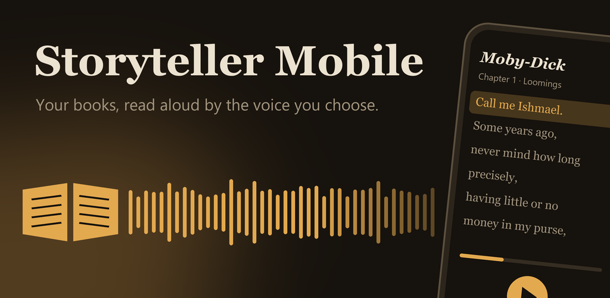
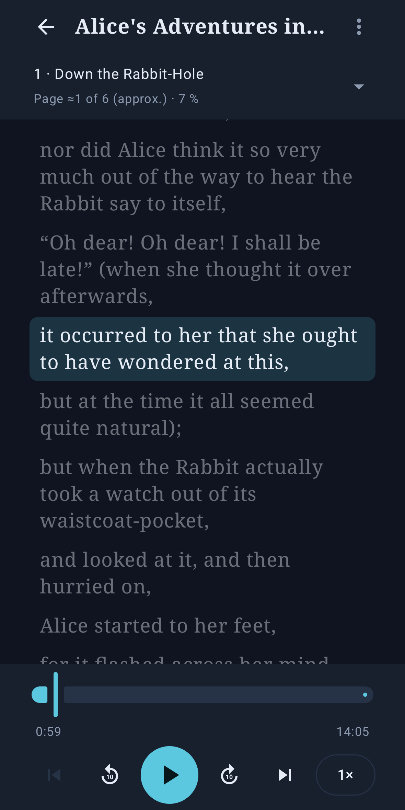
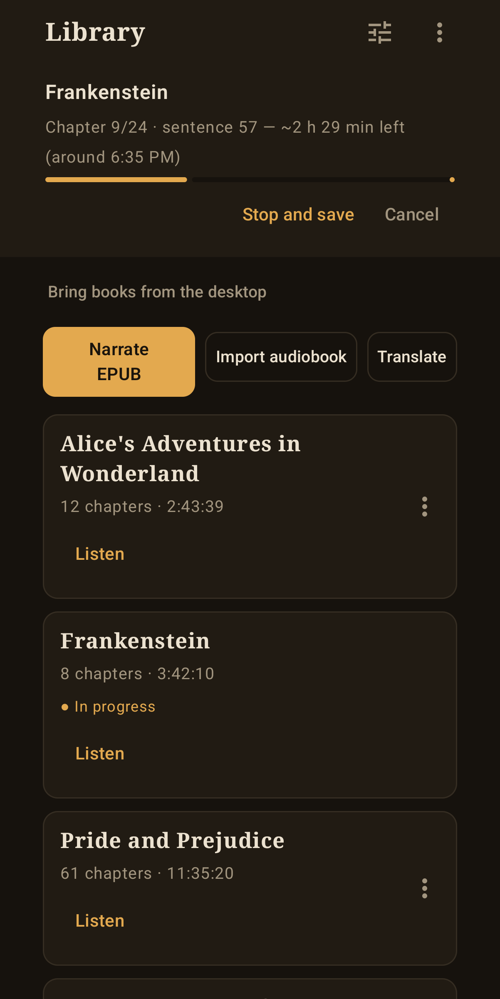
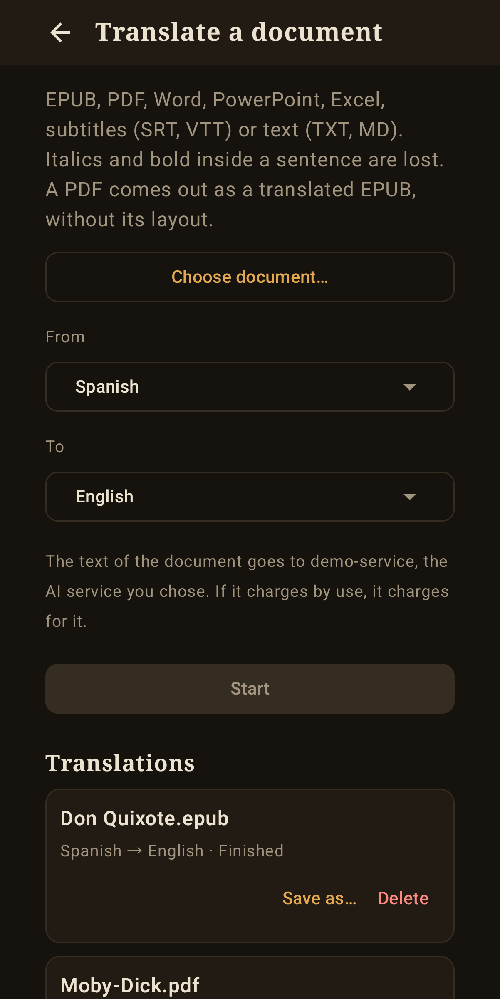
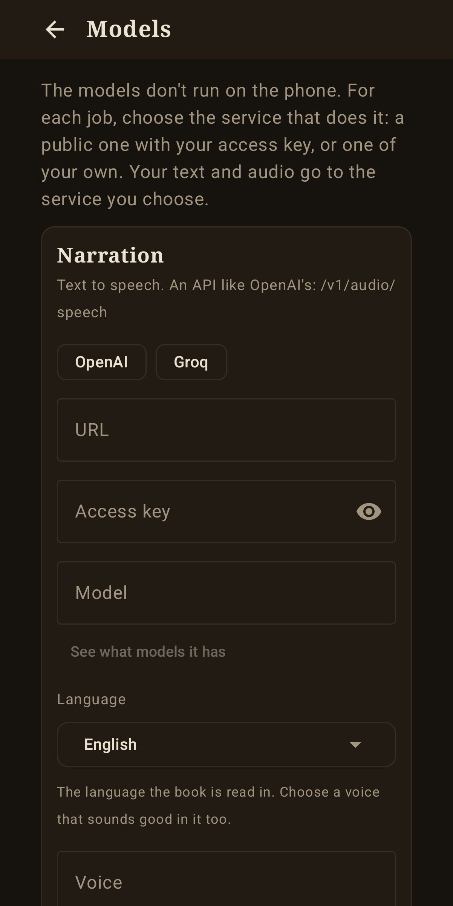

# Storyteller Mobile

<a href="README.md">English</a> · Español

  

  
  
  
  

App de Android que convierte un **EPUB en un audiolibro narrado** con voz neural y lo reproduce con
**subtítulos que siguen el audio**. También **importa audiolibros** y los transcribe para hacer esos
subtítulos, y **traduce libros y documentos**.

**En el teléfono no corre ningún modelo**, así que la app ocupa poco. Para cada trabajo eliges el servicio
que lo hace: uno público con tu clave de acceso o uno tuyo en tu red. Funciona por sí sola: no necesitas la
[app de escritorio](https://github.com/javimentallab/Storyteller), aunque su servidor funciona con esta.

En inglés, español, portugués, francés, alemán, italiano, neerlandés, polaco, ruso, ucraniano, chino,
japonés, coreano, tailandés e hindi.

## Funciones

- **Narrar un EPUB** en el idioma y con la voz que elijas. Varias peticiones a la vez si el servicio lo
  permite, y cada frase se escribe en orden. **Lee de seguido**: cada frase va entera a la voz, y las pausas
  las marcan los puntos y los párrafos del libro.
- **Reanudar** donde se quedó y **escuchar mientras narra**.
- **Comprobar y rehacer** las frases que suenan mal: cada una pasa por el servicio de transcripción y, si no
  coincide con el texto, se vuelve a pedir. Es opcional y más lento.
- **Diccionario de pronunciación**, uno por idioma.
- **Importar un audiolibro**: se copia al teléfono y se transcribe en trozos de dos minutos, cortando en los silencios.
- **Traducir** EPUB, PDF, Word, PowerPoint, Excel, subtítulos (SRT, VTT) y texto (TXT, MD). Un PDF sale como
  EPUB traducido, sin su maquetación. Los PDF escaneados no se leen.
- **Reproductor** con capítulos, saltos a cualquier posición y reproducción en segundo plano. Muestra la
  **página** por la que vas, la del libro impreso cuando el EPUB la trae, y el texto vuelve a seguir a la voz
  cinco segundos después de desplazarlo.
- **Un trabajo a la vez**, con cola. Al pasar a otro trabajo se guarda lo que lleva el primero.

## Servicios

Cada trabajo tiene su URL, su clave de acceso y su modelo, en *Modelos*. Vale cualquiera con una API como la de OpenAI:

| Trabajo | Dirección | Por ejemplo |
|---|---|---|
| Narración | `/v1/audio/speech` | un servicio de voz público, o tu propio XTTS con `st_server` de la [app de escritorio](https://github.com/javimentallab/Storyteller) |
| Transcripción | `/v1/audio/transcriptions` | Whisper, público o tuyo |
| Traducción | `/v1/chat/completions` | cualquier modelo de chat, también Ollama y llama.cpp |

Subir una voz y traer libros terminados del escritorio solo funcionan con `st_server`.

Los modelos que dan tiempos por palabra (como `whisper-1`) hacen mejores subtítulos. Con los que solo devuelven
texto, el tiempo se reparte por longitud dentro de cada trozo de dos minutos.

Se ha probado con servicios propios: XTTS, Piper, Whisper y TranslateGemma. **Los servicios públicos de pago no
se han probado.**

## Privacidad

Tu texto y tu audio van a los servicios que elijas y a nada más. Quien lleva un servicio puede ver lo que le
mandas, y uno de pago lo cobra: la app te dice cuánto texto enviará antes de narrar. Las claves de acceso se
guardan cifradas con el Keystore de Android. La app avisa cuando un texto viajaría sin cifrar más
allá de tu red de casa, y ahí no envía tu clave. Más en [PRIVACY](PRIVACY.md), en inglés.

## Instalar

Descarga el APK de la [última versión](https://github.com/javimentallab/Storyteller-Mobile/releases/latest).
Necesita Android 8.0 o posterior. Para compilarla tú, consulta [CONTRIBUTING](CONTRIBUTING.md), en inglés.

En Android 15 el sistema limita este tipo de trabajo en segundo plano a 6 horas al día. Cuando pasa, la app se
detiene y guarda, y luego puedes reanudarla.

## Contribuir

Consulta [CONTRIBUTING](CONTRIBUTING.md), en inglés. Para avisar en privado de un problema de seguridad, consulta [SECURITY](SECURITY.md).

## Licencia

[PolyForm Noncommercial 1.0.0](LICENSE): se permite cualquier uso no comercial; el uso comercial necesita permiso del autor. Las versiones hasta la 1.1.4 se publicaron con licencia MIT. Las bibliotecas y datos de terceros que lleva el APK están en [NOTICE](NOTICE).
