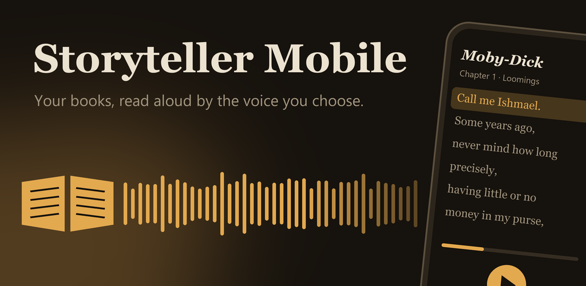
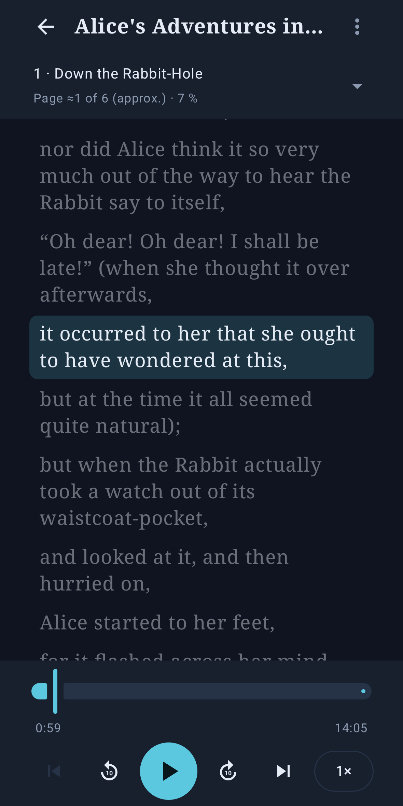
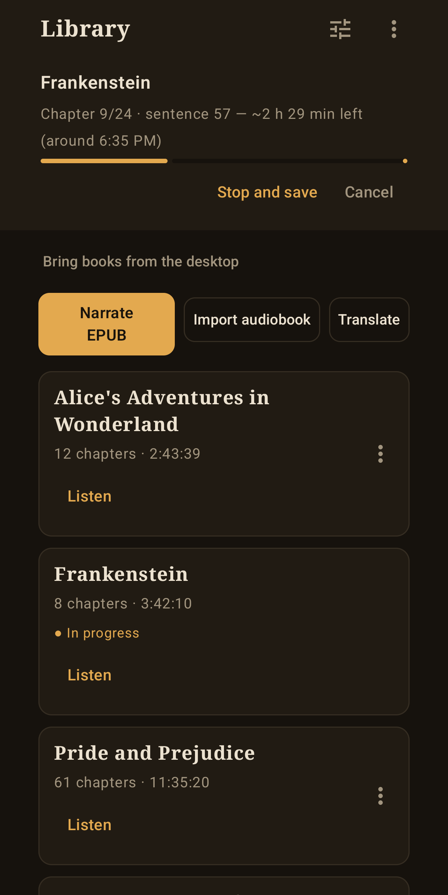
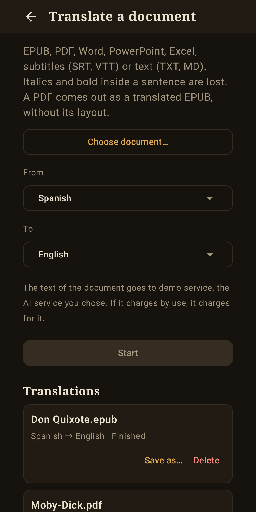
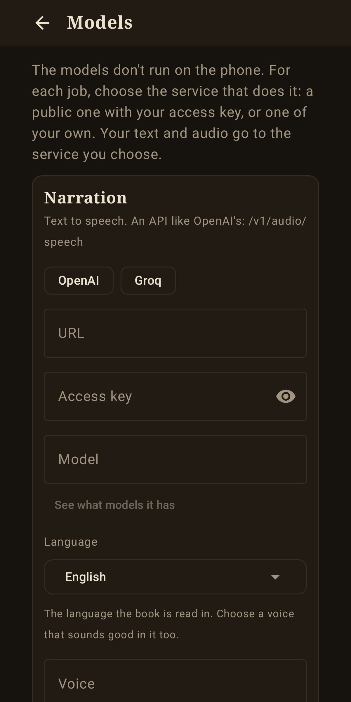

# Storyteller Mobile

English · <a href="README.es.md">Español</a>

  

  
  
  
  

Android app that turns an **EPUB into a narrated audiobook** with a neural voice and plays it with
**subtitles that follow the audio**. It also **imports audiobooks** and transcribes them to make those
subtitles, and **translates books and documents**.

**No model runs on the phone**, so the app stays small. For each job you choose the service that does it:
a public one with your access key, or one of your own on your network. It stands on its own: you don't
need the [desktop app](https://github.com/javimentallab/Storyteller), though its server works with this one.

In English, Spanish, Portuguese, French, German, Italian, Dutch, Polish, Russian, Ukrainian, Chinese,
Japanese, Korean, Thai and Hindi.

## Features

- **Narrate an EPUB** in the language you choose, with the voice you choose. Several requests at a time if
  the service allows it, and each sentence is written in order. It **reads on**: each sentence goes to the
  voice whole, and the pauses come from the book's full stops and paragraphs.
- **Resume** where it stopped, and **listen while it narrates**.
- **Check and redo** sentences that sound wrong: each one goes to the transcription service and, if it
  doesn't match the text, is asked for again. Optional, and slower.
- **Pronunciation dictionary**, one for each language.
- **Import an audiobook**: it is copied to the phone and transcribed in pieces of two minutes, cut at silences.
- **Translate** EPUB, PDF, Word, PowerPoint, Excel, subtitles (SRT, VTT) and text (TXT, MD). A PDF comes out
  as a translated EPUB, without its layout. Scanned PDFs aren't read.
- **Player** with chapters, jumps to any position and playback in the background. It shows the **page** you
  are on, the printed book's own when the EPUB carries it, and the text follows the voice again five seconds
  after you scroll.
- **One job at a time**, with a queue. Switching to another job saves what the first has done.

## Services

Each job has its own URL, access key and model, in *Models*. Anything with an API like OpenAI's works:

| Job | Endpoint | For example |
|---|---|---|
| Narration | `/v1/audio/speech` | a public voice service, or your own XTTS with `st_server` from the [desktop app](https://github.com/javimentallab/Storyteller) |
| Transcription | `/v1/audio/transcriptions` | Whisper, public or your own |
| Translation | `/v1/chat/completions` | any chat model, also Ollama and llama.cpp |

Uploading a voice and bringing finished books from the desktop only work with `st_server`.

Models that give word timings (such as `whisper-1`) make better subtitles. With those that only return text,
the time is shared out by length inside each piece of two minutes.

It has been tested with services of our own: XTTS, Piper, Whisper and TranslateGemma. **Public paid services
haven't been tested.**

## Privacy

Your text and audio go to the services you choose, and to nothing else. Whoever runs a service can see what
you send it, and a paid service charges for it: the app tells you how much text it will send before narrating.
Access keys are stored encrypted with the Android Keystore. The app warns you when a text would travel
without encryption beyond your home network, and it doesn't send your key there. More in [PRIVACY](PRIVACY.md).

## Install

Download the APK from the [latest release](https://github.com/javimentallab/Storyteller-Mobile/releases/latest).
It needs Android 8.0 or later. To build it yourself, see [CONTRIBUTING](CONTRIBUTING.md).

On Android 15 the system limits this kind of background work to 6 hours a day. When that happens, the app stops
and saves, and you can resume it later.

## Contributing

See [CONTRIBUTING](CONTRIBUTING.md). To report a security problem privately, see [SECURITY](SECURITY.md).

## License

[PolyForm Noncommercial 1.0.0](LICENSE): any noncommercial use is allowed; commercial use needs the author's permission. Versions up to 1.1.4 were released under the MIT licence. The third-party libraries and data in the APK are listed in [NOTICE](NOTICE).
